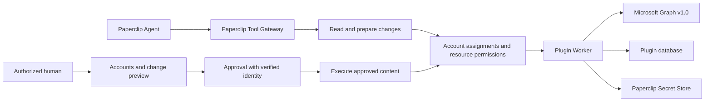
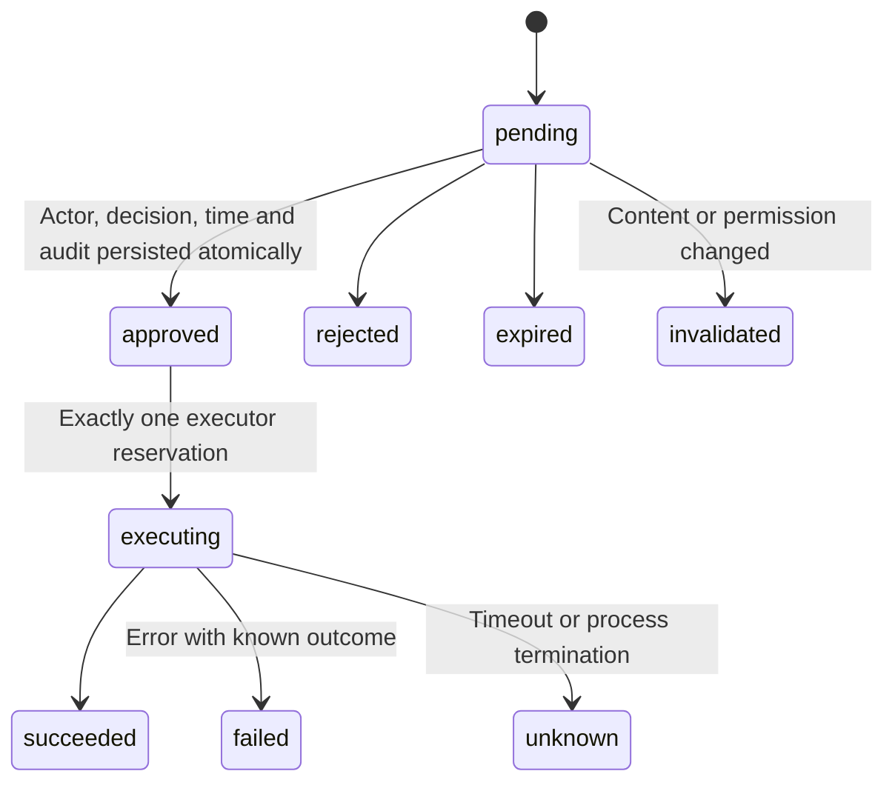

# Microsoft 365 Plugin Plan

As of 15 November 2026. The goal is a standalone native Paperclip plugin for Outlook, calendars and OneDrive. Implementation starts after this planning phase; connecting production Microsoft 365 accounts is outside the research scope.

## Product scope

The first version supports both confirmed account models: an agent can receive its own Microsoft 365 connection, and multiple agents can use the same connection with different permissions. Selecting a Microsoft account does not automatically grant access to any other agent.

| Area | First version | Later extensions |
| --- | --- | --- |
| Outlook | Read folders and messages, message details, create and update drafts, reply drafts, send new messages, delete messages | Forward drafts, large attachments, rules, archive management |
| Calendar | Calendar list, bounded calendar view, details, create, update and delete events; read recurring events | Edit recurring events, attendee responses, room lookup, meeting search |
| OneDrive | Metadata, folder contents, transfer text and binary files, create folders, create and replace files, rename, delete | Large transfers, external shared drives, SharePoint libraries, sharing links |
| Administration | Connect and disconnect accounts, agent assignments, resource permissions, preview, approval, execution status | Organization-wide distribution and additional Microsoft clouds |

Version 1 targets Microsoft 365 business accounts in the global Microsoft cloud. Shared connections initially mean that multiple authorized Paperclip agents use the same signed-in identity. Exchange shared mailboxes are an additional resource type with their own prerequisites and belong to extension package WP12.

OneDrive files are transferred as files. Editing Word contents, Excel cells or PowerPoint slides requires dedicated file-format capabilities and is outside the base scope. Text can be read and written directly; for binary files, the plugin provides bytes with metadata and a clear size limit.

## Architecture decisions

| Decision | Planned implementation | Rationale |
| --- | --- | --- |
| Plugin rather than adapter | Paperclip Plugin SDK, manifest, worker and React UI | These capabilities extend tools and administration, not the agent runtime adapter. |
| Dedicated Graph client | Curated Microsoft Graph v1.0 calls | A small, reviewable surface and precise mapping of actions, permissions and side effects. |
| Softeria as a reference | Feature comparison, MSAL concept, tool filters and separate read permissions | Softeria is not required as another process or access service. |
| Delegated access | Sign-in by an authorized Microsoft user | Version 1 does not require organization-wide application permissions. |
| Separate accounts and agents | Account connections plus explicit agent assignments | Supports private and shared accounts without implicit permission inheritance. |
| Specific approvals | Prepare changes first; execute human-confirmed content on the server | OAuth write permissions do not distinguish, for example, between creating and deleting a file. |
| Durable state | Plugin-owned database namespace, encrypted sensitive content | Executions and pending approvals survive worker restarts. |

Softeria documents MSAL, a read-only mode, tool filters and permissions derived from enabled tools. These principles are adopted; its much larger tool surface is limited to the requested areas. Any later code reuse must retain provenance and license notices. [Softeria](https://github.com/Softeria/ms-365-mcp-server)

Paperclip's plugin runtime is documented as alpha. WP00 checked the running host as `2026.1106.0+131.git.c645b7795b.dirty` at commit `c645b7795b5665eaafb3a30fe23e2deb0811dc6e`, Node.js `24.22.1` and SDK source version `1.0.0`. Because the checkout already contained unrelated changes, [ADR 0001](../decisions/0001-paperclip-runtime-contracts.md) additionally binds the contract to a self-verifying commit/diff/file/runner fingerprint. The package name `@paperclipai/plugin-sdk` with version `1.0.0` alone remains insufficient evidence of compatibility. WP01 starts feature code only after a clean, obtainable SDK/Shared pin, lock/integrity evidence and another passing probe run. [Plugin SDK](https://docs.paperclip.ing/reference/plugins/sdk/)

## Plugin structure



Agent tools validate their inputs and check current account assignments and resource permissions before each access. For changes, they first create a request. Only the execution service owns the internal call path for Graph writes. Agents receive no general HTTP tool, tokens or freely selectable Graph path.

The UI shows account connections, agent assignments, permissions, pending requests and results. Account sign-in, permission assignment and confirmation use only human identities supplied by the host. A field such as `approvedBy` in a tool argument is not proof of approval.

The examined SDK contract provides immutable actor context for `performAction`. In contrast, `getData` handlers have no equivalent actor parameter. Account data and sensitive previews are therefore loaded through a demonstrably authenticated action or API path. WP00 verified this actor context in the action harness and the subsequent CAS reservation, but not complete persistence of the human decision or a separate executor stage; both are hard WP03 gates. [SDK protocol](https://github.com/paperclipai/paperclip/blob/304e40fe9c6dde1d273710c30c137f62f1db4593/packages/plugins/sdk/src/protocol.ts), [SDK types](https://github.com/paperclipai/paperclip/blob/304e40fe9c6dde1d273710c30c137f62f1db4593/packages/plugins/sdk/src/types.ts)

## Accounts and permissions

A connection always belongs to a Paperclip company and contains the tenant ID, Microsoft account ID, signed-in identity, scopes actually granted and its state. An assignment links a Paperclip agent to that connection and the allowed actions and resources. The account label is for display only; authorization uses stable IDs.

Examples of resource permissions include a particular calendar, allowed mail folders or a OneDrive folder tree. A DriveItem is assigned using its drive ID, item ID and verified parent chain. A simple path-string check is insufficient. Links to external drives remain blocked initially.

Effective permission is the intersection of Microsoft consent, Paperclip access, plugin agent assignment and resource rule. Current rules are checked again on every execution. Revoking permissions or changing accounts invalidates pending approvals.

For business accounts, `Mail.Read`, `Calendars.Read` and `Files.Read` are initially planned as the read profile. Write capabilities selectively add `Mail.ReadWrite`, `Mail.Send`, `Calendars.ReadWrite` and `Files.ReadWrite`. An additional scope is requested only after deliberate activation of the corresponding capability. The exact mapping is in [API and permissions](../api-and-permissions.md).

These scopes do not restrict access to individual agents or folders. In particular, `Files.ReadWrite` already permits file modifications and deletions. The plugin enforces finer restrictions; later Microsoft-side restrictions to selected resources will be assessed separately. [Graph permissions reference](https://learn.microsoft.com/en-us/graph/permissions-reference)

## Sign-in and secrets

A dedicated Microsoft Entra app registration and MSAL Node are planned. Device Code is the preferred candidate for the first local pilot: an authorized human starts sign-in in the plugin UI and signs in directly with Microsoft. The plugin receives no Microsoft passwords. This flow requires no OAuth callback in the plugin router. It is used only if tenant policies permit it. [Device Authorization](https://learn.microsoft.com/en-us/entra/identity-platform/v2-oauth2-device-code)

WP00 confirms Device Code as the preferred candidate but leaves its use open until the approved tenant check in WP02. The current plugin route contract provides no demonstrated unauthenticated OAuth callback for Microsoft. If the tenant prohibits Device Code, Authorization Code with PKCE will be planned only after concrete verification of the callback, redirect URI, `state`, code-verifier storage and server-side exchange. A tenant restriction is not bypassed using another flow. [ADR 0001](../decisions/0001-paperclip-runtime-contracts.md), [Authorization Code](https://learn.microsoft.com/en-us/entra/identity-platform/v2-oauth2-auth-code-flow)

MSAL manages the token cache and refresh. An encrypted cache per company and connection is planned, with version checks against concurrent writes. The encryption key is resolved through Paperclip as a `secret_ref`. The worker stores only encrypted cache data; tokens, device codes and download URLs appear neither in tool responses nor in logs or Git. Sign-in codes may appear only in the human-initiated sign-in form. [MSAL cache](https://learn.microsoft.com/en-us/entra/msal/javascript/node/caching)

The examined SDK provides `ctx.secrets.resolve()` but no general secret-writing service for token rotation. An undocumented `ctx.secrets.set()` is therefore not part of the plan. Cache-key provisioning and rotation will be implemented in WP02 using the existing secret store. If the key is missing, the connection remains blocked. [SDK types](https://github.com/paperclipai/paperclip/blob/304e40fe9c6dde1d273710c30c137f62f1db4593/packages/plugins/sdk/src/types.ts)

Disconnecting a connection blocks further calls, discards pending requests and deletes its local token cache. This is distinct from revoking Microsoft consent; that administrative procedure will be documented. Existing OWA sessions do not replace a dedicated Graph sign-in.

## Preview and approval

The first version requires action-specific human approval for every external change, including saving an Outlook draft. Authorized agents may prepare such changes. The approval UI shows the actual effect:

- Email: sending account, To/Cc/Bcc, subject, content, attachments and hash of the approved payload.
- Calendar: calendar, date, time, time zone, attendees, recurrence scope and possible invitations or cancellations.
- OneDrive: drive, target folder, filename, new and old metadata, file size, content hash and effect on existing files.
- Deletion: specific object ID, readable description, current state and expected deletion effect.

A prepared request binds the company, connection, Microsoft identity, requesting agent, action, target object, immutable payload hash, resource state, policy version and expiry. Previews containing mail or file contents are encrypted and retained only as long as necessary. Confirmation comes from a configured, authorized human host user. An agent may neither choose that user nor approve itself.

WP03 first persists the actual host-supplied actor ID, decision, decision time and audit correlation atomically with the transition to `approved`. Only then does a separate executor stage reserve the request through exactly one atomic transition to `executing`, load only the reserved immutable snapshot and recheck scopes and rules. Audit and state transition share a demonstrated atomic path or verified fail-closed compensation. Parallel clicks or agent calls must not execute the same change more than once; content changes require new approval.



When the outcome is uncertain, the mutation is not blindly retried. Local execution evidence prevents repetition within the plugin but does not guarantee exactly-once effects at Microsoft. Calendar creation additionally uses the documented `transactionId`. There is no general Graph idempotency guarantee for sending email. [Event resource](https://learn.microsoft.com/en-us/graph/api/resources/event?view=graph-rest-1.0)

Paperclip's tool gateway remains upstream of the plugin. Approval does not rely solely on its risk classification. WP00 found no plugin-side native create-and-bind approval contract for the complete M365 payload. Confirmation is therefore planned as an authenticated `performAction` against an `operationId`; JSON fields such as `approvedBy` have no effect. WP00 demonstrates snapshot binding, current actor/permission checks and exactly one CAS reservation to `executing`, but not the persisted actual decision, audit correlation or subsequent separate execution. WP03 must demonstrate these missing parts and all states `approved`, `executing`, `succeeded`, `failed`, `unknown` in the real plugin implementation before any Graph mutation is permitted. No fictitious core approval API is assumed. [ADR 0001](../decisions/0001-paperclip-runtime-contracts.md), [Tool Gateway](https://github.com/paperclipai/paperclip/blob/304e40fe9c6dde1d273710c30c137f62f1db4593/server/src/services/tool-gateway.ts)

## Domain rules

### Email

Lists initially return compact metadata; message bodies are loaded explicitly. HTML is sanitized and external images are not loaded automatically. Message contents and attachments are untrusted data. Immutable IDs are used for Outlook resources where possible. [Read messages](https://learn.microsoft.com/en-us/graph/api/user-list-messages?view=graph-rest-1.0), [Immutable IDs](https://learn.microsoft.com/en-us/graph/outlook-immutable-id)

The first sending capability uses `sendMail` with the immutable approved content. This prevents later changes to a separate Outlook draft from being sent accidentally. An imported Outlook draft is retained unless its deletion is separately approved. Directly sending existing mutable Outlook drafts will be offered only after their concurrency conditions have been examined.

A `202 Accepted` is displayed as accepted by Microsoft, not as delivery confirmation. A timeout after the send call produces an uncertain status; the plugin does not automatically send again. Deletion uses only the normal Delete operation and blocks permanent deletion and repeated deletion from recovery folders. Recoverability depends on Exchange retention and the current folder. [sendMail](https://learn.microsoft.com/en-us/graph/api/user-sendmail?view=graph-rest-1.0), [Delete message](https://learn.microsoft.com/en-us/graph/api/message-delete?view=graph-rest-1.0)

### Calendar

Event lists use `calendarView` with a start and end for the time window so recurring occurrences appear correctly. The UI displays an understandable time zone; tests cover Europe/Berlin and daylight-saving transitions. Version 1 reads series and exceptions but blocks changes to series or individual recurring occurrences. [calendarView](https://learn.microsoft.com/en-us/graph/api/user-list-calendarview?view=graph-rest-1.0)

An event with attendees can send invitations; deleting an organizer's event can send cancellations. Both effects belong in the preview. Changes to existing online meetings preserve existing meeting information. ETag or `changeKey` checks are promised as atomic protection only where the endpoint demonstrably supports them; a preliminary comparison alone does not prevent an external change between read and write. [Create event](https://learn.microsoft.com/en-us/graph/api/user-post-events?view=graph-rest-1.0), [Delete event](https://learn.microsoft.com/en-us/graph/api/event-delete?view=graph-rest-1.0), [Update event](https://learn.microsoft.com/en-us/graph/api/event-update?view=graph-rest-1.0)

### OneDrive

Version 1 supports at most 4 MiB of raw text or binary data per file. WP00 checks canonical Base64, encoded length and exact raw length before allocating decoding memory, validates again after decoding, and binds the action, target, identities, policy and complete file contents into the canonical operation hash. The scoped plugin API, separately limited to 1,000,000 bytes, is not a file transport. WP08 must demonstrate boundary cases, concurrency, peak RSS, timeouts and rate/concurrency limits before external file I/O. Larger files require WP13. No unavailable `ctx.assets` capability is assumed. [ADR 0001](../decisions/0001-paperclip-runtime-contracts.md), [SDK README](https://github.com/paperclipai/paperclip/blob/304e40fe9c6dde1d273710c30c137f62f1db4593/packages/plugins/sdk/README.md)

New files explicitly use `@microsoft.graph.conflictBehavior=fail` in the request URL; the documented PUT default would replace existing files. WP08 verifies this conflict rule with the actual upload operation. Replacement and deletion require a specific target and use documented `If-Match` where supported. No automatic overwrite is offered without verified protection. Version 1 folder deletion covers only empty folders. Normal OneDrive Delete moves items to the recycle bin. [DriveItem contract](https://learn.microsoft.com/en-us/graph/api/resources/driveitem?view=graph-rest-1.0), [Update DriveItem](https://learn.microsoft.com/en-us/graph/api/driveitem-update?view=graph-rest-1.0), [Delete DriveItem](https://learn.microsoft.com/en-us/graph/api/driveitem-delete?view=graph-rest-1.0)

Download redirects and, later, upload-session URLs are handled server-side. They are temporary access credentials and are not passed to agents or logs. The Graph bearer token is not sent to the downstream file URL. Destinations, HTTPS and redirect chains are checked; arbitrary download URLs supplied by agents remain prohibited. [Download files](https://learn.microsoft.com/en-us/graph/api/driveitem-get-content?view=graph-rest-1.0)

## Storage and operations

Tables are planned for `connections`, `agent_bindings`, `resource_rules`, `token_caches`, `operations` and `audit_events`, each with a mandatory company reference. Sensitive payloads and token caches are encrypted; technical audit data contains IDs, action, actor, hash, timestamp, outcome and Microsoft request ID. Contents, recipient lists and filenames must not enter general host logs without review.

In the examined version, `ctx.db` supports restricted individual SQL statements. Operation reservation therefore uses a conditional `UPDATE` with a checked `rowCount`; no undocumented multi-statement transaction API is assumed. WP03 repeats the local PostgreSQL evidence in the actual plugin implementation and adds atomic actor/decision/time/audit persistence, a separate executor stage, allowed state transitions, exactly one executor, replay, restart, permission revocation, payload tampering, and `succeeded`, `failed` and persistently blocked `unknown`. An uncertain audit path must fail closed. Migrations modify only the plugin schema. [Plugin Authoring Guide](https://github.com/paperclipai/paperclip/blob/304e40fe9c6dde1d273710c30c137f62f1db4593/doc/plugins/PLUGIN_AUTHORING_GUIDE.md)

Read lists have fixed limits and a continuation marker bound to the identity and request. Graph `nextLink` is used unchanged internally but checked for origin and resource scope. Responses indicate whether more results exist. `429` respects `Retry-After`; automatic retries are limited to demonstrably safe cases. [Paging](https://learn.microsoft.com/en-us/graph/paging), [Throttling](https://learn.microsoft.com/en-us/graph/throttling)

Version 1 operates on request. Delta synchronization, public webhooks and persistent background runs will be added only when specifically needed. Disabling the plugin stops new access. WP04, WP10 and WP11 collect the mandatory content-free inventory of `unknown` count/age, approval-to-execution time, authorization and size rejections, Graph `429`/`Retry-After`/`5xx`, token/secret, worker/DB/migration errors, operation/audit growth, and latency and outcome per allowed operation type. Only fixed labels for operation type, outcome, error class, status class, Retry-After bucket and component are allowed; identity, resource, operation and content values are prohibited. Cardinality limits are in the [work packages](../work-packages.md). Named thresholds, dashboard/alarm evidence, a runbook drill and privacy review are acceptance conditions.

Before every installation or migration, the following fixed sequence is a hard gate: version-bound host/SDK/Shared/package preflight, backup with secure key mapping and isolated restore, additive/backward-compatible migration, installation with the plugin disabled, enablement with health/migration checks, a read-only pilot with synthetic data, separately human-approved individual write/delete cases, an observation window, and completion or rollback. The previous compatible package version is retained. Preflight, backup/restore, migration, health, secret/token, worker/DB or signal-threshold failures and open/new `unknown` operations stop the procedure. Disable the plugin before rollback; pending and uncertain mutations are never automatically re-executed after restore. If the additive schema is not backward-readable, restore the package, data backup and key only as a matching set.

## Planned repository structure

```text
src/
  manifest.ts
  worker.ts
  auth/          # MSAL, sign-in, encrypted cache
  graph/         # allowed endpoints, pagination, errors and transport
  policy/        # agent assignments and resource checks
  operations/    # preview, approval, reservation and execution
  mail/
  calendar/
  drive/
  ui/            # accounts, permissions, previews and status
migrations/
tests/
docs/
```

Planned plugin ID: `srahmel.m365`; planned package name: `paperclip-plugin-m365`, subject to name availability. The manifest includes only required capabilities: agent tools, outbound HTTP, secret references, plugin database, activity log and the UI slots used. Additional API routes or jobs are declared only if the verified transport solution requires them.

## Milestones and acceptance

1. **M0 Architecture confirmed:** WP00 and WP01 establish the host contract, sign-in, transport and package structure.
2. **M1 Reads available:** Private and shared account connections work; authorized agents can read all three areas. Denied access is also demonstrated.
3. **M2 Changes available:** Mail, calendar and OneDrive support the intended mutations with previews, approval and traceable outcomes.
4. **M3 Pilot and release:** Independent operations and security review, test-account acceptance and installation of the packed artifact have passed.

The mandatory packages WP00 through WP11 are estimated at **33 to 49 person-days** after including the additional operational evidence; this includes about 2 person-days for WP00 and Hagen's additional 2 to 4 person-days for metrics, capacity evidence, preflight, backup/restore, observation and rollback. Administrative waiting time, Microsoft consent and external review waiting time are excluded. The consistent breakdown is in the [work packages](../work-packages.md).

Before the production pilot, the access rules of the relevant installation must explicitly permit the new direct Graph access. Installing the plugin does not override an existing OWA-only restriction. Production write and delete tests each require specifically named test objects and corresponding approval.
