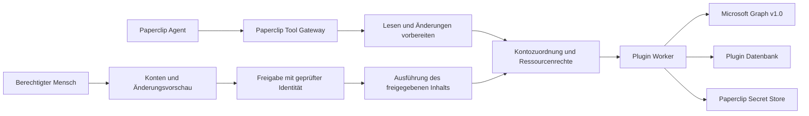
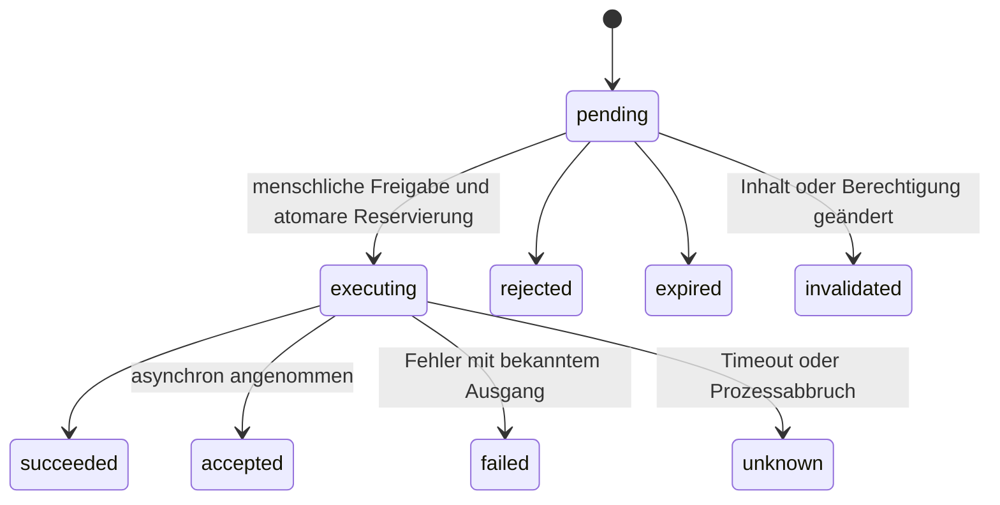

# Planung des Microsoft 365 Plugins

Stand: 15. November 2026. Ziel ist ein eigenständiges natives Paperclip-Plugin für Outlook, Kalender und OneDrive. Die Umsetzung beginnt nach dieser Planungsphase; eine Verbindung zu produktiven Microsoft-365-Konten ist kein Bestandteil der Recherche.

## Produktumfang

Die erste Version unterstützt beide bestätigten Kontomodelle: Ein Agent kann eine eigene Microsoft-365-Verbindung erhalten, und mehrere Agenten können dieselbe Verbindung mit unterschiedlichen Rechten verwenden. Die Auswahl eines Microsoft-Kontos erteilt keinem weiteren Agenten automatisch Zugriff.

| Bereich | Erste Version | Spätere Erweiterungen |
| --- | --- | --- |
| Outlook | Ordner und Nachrichten lesen, Nachrichtendetails, Entwürfe anlegen und ändern, Antwortentwürfe, neue Nachrichten senden, Nachrichten löschen | Weiterleitungsentwürfe, große Anhänge, Regeln, Archivverwaltung |
| Kalender | Kalenderliste, zeitlich begrenzte Terminansicht, Details, Anlegen, Ändern und Löschen; Serientermine lesen | Serien bearbeiten, Teilnehmerantworten, Raumsuche, Meeting-Suche |
| OneDrive | Metadaten, Ordnerinhalt, Text und Binärdateien übertragen, Ordner anlegen, Dateien erstellen und ersetzen, umbenennen, löschen | Große Übertragungen, fremde freigegebene Drives, SharePoint-Bibliotheken, Freigabelinks |
| Verwaltung | Konto verbinden und trennen, Agentenzuordnung, Ressourcenrechte, Vorschau, Freigabe, Ausführungsstatus | Organisationsweite Verteilung und zusätzliche Microsoft-Clouds |

Version 1 richtet sich an Microsoft-365-Geschäftskonten in der globalen Microsoft-Cloud. Gemeinsam genutzte Verbindungen bedeuten zunächst, dass mehrere berechtigte Paperclip-Agenten dieselbe angemeldete Identität verwenden. Exchange Shared Mailboxes sind ein zusätzlicher Ressourcentyp mit eigenen Voraussetzungen und gehören in das Erweiterungspaket WP12.

OneDrive-Dateien werden als Dateien übertragen. Die Bearbeitung von Word-Inhalten, Excel-Zellen oder PowerPoint-Folien benötigt eigene Dateiformatfunktionen und gehört nicht zum Basisumfang. Texte können direkt gelesen und geschrieben werden; für Binärdateien liefert das Plugin Bytes mit Metadaten und einer klaren Größenbegrenzung.

## Architekturentscheidungen

| Entscheidung | Geplante Umsetzung | Begründung |
| --- | --- | --- |
| Plugin statt Adapter | Paperclip Plugin SDK, Manifest, Worker und React-Oberfläche | Die Funktionen erweitern Werkzeuge und Verwaltung, nicht den Agentenlaufzeitadapter. |
| Eigener Graph-Client | Kuratierte Microsoft-Graph-v1.0-Aufrufe | Kleine überprüfbare Oberfläche und genaue Zuordnung von Aktionen, Rechten und Nebenwirkungen. |
| Softeria als Referenz | Funktionsvergleich, MSAL-Konzept, Toolfilter und getrennte Leserechte | Softeria wird nicht als weiterer Prozess oder Zugangsdienst vorausgesetzt. |
| Delegierter Zugriff | Anmeldung eines berechtigten Microsoft-Benutzers | Version 1 benötigt keine organisationsweiten Application Permissions. |
| Konto und Agent getrennt | Kontoverbindungen plus explizite Agentenzuordnungen | Unterstützt eigene und gemeinsame Konten ohne implizite Berechtigungsvererbung. |
| Konkrete Freigaben | Änderungen zunächst vorbereiten; menschlich bestätigten Inhalt serverseitig ausführen | OAuth-Schreibrechte unterscheiden beispielsweise nicht zwischen Datei anlegen und Datei löschen. |
| Dauerhafte Zustände | Plugin-eigener Datenbankbereich, verschlüsselte sensible Inhalte | Ausführungen und offene Freigaben überstehen einen Worker-Neustart. |

Softeria dokumentiert MSAL, einen Lesemodus, Toolfilter und aus den aktivierten Werkzeugen abgeleitete Berechtigungen. Diese Prinzipien werden übernommen; seine wesentlich größere Werkzeugoberfläche wird auf die angefragten Bereiche begrenzt. Eine spätere Codeübernahme muss Herkunft und Lizenzhinweise erhalten. [Softeria](https://github.com/Softeria/ms-365-mcp-server)

Paperclips Plugin-Laufzeit ist als Alpha dokumentiert. WP00 hat den laufenden Host als `2026.1106.0+131.git.c645b7795b.dirty` auf Commit `c645b7795b5665eaafb3a30fe23e2deb0811dc6e`, Node.js `24.22.1` und SDK-Quellversion `1.0.0` geprüft. Weil der Checkout bereits fremde Änderungen enthielt, bindet [ADR 0001](../decisions/0001-paperclip-runtime-contracts.md) den Vertrag zusätzlich an einen selbstprüfenden Commit-/Diff-/Datei-/Runner-Fingerprint. Der Paketname `@paperclipai/plugin-sdk` mit Version `1.0.0` allein reicht weiterhin nicht als Kompatibilitätsnachweis aus. WP01 beginnt Featurecode erst nach einem sauber erhältlichen SDK-/Shared-Pin, Lock-/Integritätsnachweis und erneut grünem Probe-Lauf. [Plugin SDK](https://docs.paperclip.ing/reference/plugins/sdk/)

## Aufbau des Plugins



Die Agentenwerkzeuge validieren ihre Eingaben und prüfen vor jedem Zugriff die aktuelle Kontozuordnung und Ressourcenrechte. Für Änderungen erzeugen sie zunächst einen Auftrag. Nur der Ausführungsdienst besitzt den internen Aufrufpfad für schreibende Graph-Anfragen. Agenten erhalten kein allgemeines HTTP-Werkzeug, keine Tokens und keinen frei wählbaren Graph-Pfad.

Die Oberfläche zeigt Kontoverbindungen, Agentenzuordnungen, Berechtigungen, offene Aufträge und Ergebnisse. Kontoanmeldung, Rechtevergabe und Bestätigung verwenden ausschließlich vom Host gelieferte menschliche Identitäten. Ein Feld wie `approvedBy` im Werkzeugargument ist kein Nachweis einer Freigabe.

Der untersuchte SDK-Vertrag liefert für `performAction` einen unveränderlichen Actor-Kontext. `getData`-Handler haben dagegen keinen gleichwertigen Actor-Parameter. Kontodaten und sensible Vorschauen werden deshalb über einen nachweislich authentisierten Action- oder API-Pfad geladen. Der endgültige Transport wird in WP00 getestet. [SDK-Protokoll](https://github.com/paperclipai/paperclip/blob/304e40fe9c6dde1d273710c30c137f62f1db4593/packages/plugins/sdk/src/protocol.ts), [SDK-Typen](https://github.com/paperclipai/paperclip/blob/304e40fe9c6dde1d273710c30c137f62f1db4593/packages/plugins/sdk/src/types.ts)

## Konten und Berechtigungen

Eine Verbindung gehört immer zu einer Paperclip-Company und enthält Tenant-ID, Microsoft-Konto-ID, angemeldete Identität, tatsächlich erteilte Scopes und ihren Zustand. Eine Zuordnung verbindet einen Paperclip-Agenten mit dieser Verbindung und den erlaubten Aktionen und Ressourcen. Die Kontobezeichnung dient nur zur Anzeige; Autorisierungen verwenden stabile IDs.

Beispiele für Ressourcenrechte sind ein bestimmter Kalender, zugelassene Mailordner oder ein OneDrive-Ordnerbaum. Ein DriveItem wird anhand von Drive-ID, Item-ID und überprüfter Elternkette zugeordnet. Eine reine Zeichenkettenprüfung des Pfades reicht dafür nicht. Verknüpfungen zu fremden Drives bleiben zunächst gesperrt.

Die wirksame Berechtigung ist die Schnittmenge aus Microsoft-Consent, Paperclip-Zugriff, Plugin-Agentenzuordnung und Ressourcenregel. Bei jeder Ausführung werden die aktuellen Regeln erneut geprüft. Ein Rechtentzug oder Kontowechsel macht noch offene Freigaben ungültig.

Für Geschäftskonten sind zunächst `Mail.Read`, `Calendars.Read` und `Files.Read` als Leseprofil vorgesehen. Schreibfunktionen ergänzen gezielt `Mail.ReadWrite`, `Mail.Send`, `Calendars.ReadWrite` und `Files.ReadWrite`. Ein zusätzlicher Scope wird erst nach bewusster Aktivierung der entsprechenden Funktion angefordert. Die genaue Zuordnung steht in [API und Berechtigungen](../api-and-permissions.md).

Diese Scopes sind keine Beschränkung auf einzelne Agenten oder Ordner. Insbesondere `Files.ReadWrite` erlaubt bereits Dateiänderungen und Löschungen. Die feinere Eingrenzung übernimmt das Plugin; eine spätere Microsoft-seitige Beschränkung auf ausgewählte Ressourcen wird gesondert bewertet. [Graph-Berechtigungsreferenz](https://learn.microsoft.com/en-us/graph/permissions-reference)

## Anmeldung und Geheimnisse

Geplant ist eine eigene Microsoft-Entra-App-Registrierung und MSAL Node. Für den ersten lokalen Pilot ist Device Code der bevorzugte Kandidat: Ein berechtigter Mensch startet die Anmeldung in der Plugin-Oberfläche und meldet sich direkt bei Microsoft an. Das Plugin erhält keine Microsoft-Passwörter. Dieser Flow benötigt keinen OAuth-Callback im Plugin-Router. Er wird nur eingesetzt, wenn die Tenant-Richtlinien ihn erlauben. [Device Authorization](https://learn.microsoft.com/en-us/entra/identity-platform/v2-oauth2-device-code)

WP00 bestätigt Device Code als bevorzugten Kandidaten, lässt seine Verwendung aber bis zur freigegebenen Tenant-Prüfung in WP02 offen. Der aktuelle Plugin-Routenvertrag bietet keinen nachgewiesenen unauthentisierten OAuth-Callback für Microsoft. Falls der Tenant Device Code untersagt, wird Authorization Code mit PKCE erst nach einem konkreten Nachweis von Callback, Redirect-URI, `state`, Code-Verifier-Speicherung und serverseitigem Austausch geplant. Eine Tenant-Sperre wird nicht durch einen anderen Flow umgangen. [ADR 0001](../decisions/0001-paperclip-runtime-contracts.md), [Authorization Code](https://learn.microsoft.com/en-us/entra/identity-platform/v2-oauth2-auth-code-flow)

MSAL verwaltet den Token-Cache und die Erneuerung. Geplant ist ein verschlüsselter Cache je Company und Verbindung mit Versionsprüfung gegen konkurrierende Schreibzugriffe. Der Verschlüsselungsschlüssel wird als `secret_ref` über Paperclip aufgelöst. Der Worker speichert nur verschlüsselte Cache-Daten; Tokens, Gerätecodes und Download-URLs erscheinen weder in Werkzeugantworten noch in Logs oder Git. Anmeldecodes dürfen ausschließlich in der vom Menschen gestarteten Anmeldemaske erscheinen. [MSAL-Cache](https://learn.microsoft.com/en-us/entra/msal/javascript/node/caching)

Das untersuchte SDK bietet `ctx.secrets.resolve()`, aber keinen allgemeinen Secret-Schreibdienst für Tokenrotation. Deshalb wird kein nicht dokumentiertes `ctx.secrets.set()` eingeplant. Die Versorgung und Rotation des Cache-Schlüssels werden in WP02 mit dem vorhandenen Secret Store umgesetzt. Fehlt der Schlüssel, bleibt die Verbindung gesperrt. [SDK-Typen](https://github.com/paperclipai/paperclip/blob/304e40fe9c6dde1d273710c30c137f62f1db4593/packages/plugins/sdk/src/types.ts)

Trennen einer Verbindung sperrt weitere Aufrufe, verwirft offene Aufträge und löscht ihren lokalen Token-Cache. Das ist von einem Widerruf des Microsoft-Consents zu unterscheiden; dessen administrativer Ablauf wird dokumentiert. Bestehende OWA-Sitzungen ersetzen keine eigene Graph-Anmeldung.

## Vorschau und Freigabe

Die erste Version verlangt für jede externe Änderung eine aktionsbezogene menschliche Freigabe, auch für das Speichern eines Outlook-Entwurfs. Berechtigte Agenten dürfen solche Änderungen vorbereiten. Die Freigabeoberfläche zeigt die tatsächliche Wirkung:

- E-Mail: sendendes Konto, To/Cc/Bcc, Betreff, Inhalt, Anhänge und Hash der freigegebenen Nutzlast.
- Kalender: Kalender, Datum, Uhrzeit, Zeitzone, Teilnehmer, Wiederholungsumfang sowie mögliche Einladungen oder Absagen.
- OneDrive: Drive, Zielordner, Dateiname, neue und alte Metadaten, Dateigröße, Inhaltshash und Wirkung auf vorhandene Dateien.
- Löschen: konkrete Objekt-ID, lesbare Beschreibung, aktueller Zustand und erwartete Löschwirkung.

Ein vorbereiteter Auftrag bindet Company, Verbindung, Microsoft-Identität, anfragenden Agenten, Aktion, Zielobjekt, unveränderlichen Payload-Hash, Ressourcenstand, Richtlinienversion und Ablaufzeit. Vorschauen mit Mail- oder Dateiinhalten werden verschlüsselt und nur so lange wie erforderlich gespeichert. Die Bestätigung kommt von einem konfigurierten berechtigten menschlichen Host-Benutzer. Ein Agent darf weder diesen Benutzer bestimmen noch sich selbst freigeben.

Der Worker reserviert die Ausführung durch einen atomaren Zustandswechsel in der Plugin-Datenbank. Er prüft anschließend Identität, Scopes und Regeln erneut. Die Reservierung und die finale Prüfung werden so gestaltet, dass parallele Klicks oder Agentenaufrufe dieselbe Änderung nicht mehrfach ausführen. Bei Änderung des Inhalts ist eine neue Freigabe erforderlich.



Bei unklarem Ausgang wird die Mutation nicht blind wiederholt. Ein lokaler Ausführungsnachweis verhindert Wiederholungen im Plugin, garantiert aber keine Exactly-once-Wirkung bei Microsoft. Kalendererstellung verwendet zusätzlich die dokumentierte `transactionId`. Für E-Mail-Versand besteht keine allgemeine Graph-Idempotenzgarantie. [Event-Ressource](https://learn.microsoft.com/en-us/graph/api/resources/event?view=graph-rest-1.0)

Paperclips Tool Gateway bleibt vorgeschaltet. Die Freigabe stützt sich nicht allein auf seine Risikoklassifizierung. WP00 hat keinen pluginseitigen nativen Create-and-bind-Approval-Vertrag für den vollständigen M365-Payload gefunden. Die konkrete Bestätigung erfolgt deshalb als authentisierte `performAction` auf eine `operationId`; der Worker bindet die vom Host gelieferte menschliche Identität an den unveränderlichen, privat gespeicherten Payload-Hash und reserviert genau diesen Auftrag atomar. JSON-Felder wie `approvedBy` sind wirkungslos. Es wird keine fiktive Core-Approval-API eingeplant. [ADR 0001](../decisions/0001-paperclip-runtime-contracts.md), [Tool Gateway](https://github.com/paperclipai/paperclip/blob/304e40fe9c6dde1d273710c30c137f62f1db4593/server/src/services/tool-gateway.ts)

## Fachliche Regeln

### E-Mail

Listen liefern zunächst kompakte Metadaten; Nachrichtentexte werden gezielt geladen. HTML wird bereinigt, externe Bilder werden nicht automatisch geladen. Nachrichteninhalte und Anhänge gelten als unvertrauenswürdige Daten. Für Outlook-Ressourcen werden nach Möglichkeit Immutable IDs verwendet. [Nachrichten lesen](https://learn.microsoft.com/en-us/graph/api/user-list-messages?view=graph-rest-1.0), [Immutable IDs](https://learn.microsoft.com/en-us/graph/outlook-immutable-id)

Die erste Versandfunktion verwendet `sendMail` mit dem unveränderlichen, freigegebenen Inhalt. Dadurch werden spätere Änderungen an einem separaten Outlook-Entwurf nicht versehentlich mitgesendet. Ein importierter Outlook-Entwurf bleibt erhalten, solange seine Löschung nicht gesondert freigegeben wurde. Ein direktes Senden bestehender, veränderbarer Outlook-Entwürfe wird erst nach Prüfung seiner Konkurrenzbedingungen angeboten.

Ein `202 Accepted` wird als von Microsoft angenommen angezeigt, nicht als Zustellbestätigung. Bei Timeout nach dem Sendeaufruf erscheint ein unklarer Status; das Plugin sendet nicht automatisch erneut. Die Löschfunktion verwendet ausschließlich die normale Delete-Operation und sperrt endgültiges Löschen sowie wiederholtes Löschen aus Wiederherstellungsordnern. Wiederherstellbarkeit hängt von Exchange-Retention und dem aktuellen Ordner ab. [sendMail](https://learn.microsoft.com/en-us/graph/api/user-sendmail?view=graph-rest-1.0), [Delete message](https://learn.microsoft.com/en-us/graph/api/message-delete?view=graph-rest-1.0)

### Kalender

Terminlisten verwenden `calendarView` mit Anfang und Ende des Zeitfensters, damit Serienvorkommen korrekt erscheinen. Die Oberfläche zeigt eine verständliche Zeitzone; Tests decken Europe/Berlin und Sommerzeitwechsel ab. In Version 1 werden Serien und Serienausnahmen gelesen, aber Änderungen an Serien oder einzelnen Serienvorkommen gesperrt. [calendarView](https://learn.microsoft.com/en-us/graph/api/user-list-calendarview?view=graph-rest-1.0)

Ein Termin mit Teilnehmern kann Einladungen verschicken; das Löschen eines Organisator-Termins kann Absagen versenden. Beides gehört in die Vorschau. Änderungen an bestehenden Online-Meetings erhalten vorhandene Meetinginformationen. ETag- oder `changeKey`-Prüfungen werden nur dort als atomarer Schutz zugesagt, wo der jeweilige Endpoint das nachweislich unterstützt; ein Vorabvergleich allein verhindert keine externe Änderung zwischen Lesen und Schreiben. [Create event](https://learn.microsoft.com/en-us/graph/api/user-post-events?view=graph-rest-1.0), [Delete event](https://learn.microsoft.com/en-us/graph/api/event-delete?view=graph-rest-1.0), [Update event](https://learn.microsoft.com/en-us/graph/api/event-update?view=graph-rest-1.0)

### OneDrive

Version 1 unterstützt höchstens 4 MiB rohe Text- oder Binärdaten je Datei. WP00 prüft kanonisches Base64, encoded und exakte raw length vor Dekodierungsallokation, validiert nach Dekodierung erneut und bindet Aktion, Ziel, Identitäten, Policy und vollständigen Dateiinhalt in den kanonischen Operationshash. Die separat auf 1.000.000 Byte begrenzte scoped Plugin API ist kein Dateitransport. WP08 muss Grenzfälle, Parallelität, Peak RSS, Timeouts und Rate-/Concurrency-Limits vor externer Datei-I/O nachweisen. Größere Dateien benötigen WP13. Es wird kein nicht verfügbares `ctx.assets` vorausgesetzt. [ADR 0001](../decisions/0001-paperclip-runtime-contracts.md), [SDK README](https://github.com/paperclipai/paperclip/blob/304e40fe9c6dde1d273710c30c137f62f1db4593/packages/plugins/sdk/README.md)

Neue Dateien verwenden ausdrücklich `@microsoft.graph.conflictBehavior=fail` im Request-URL; der dokumentierte PUT-Standard würde vorhandene Dateien ersetzen. WP08 prüft diese Konfliktregel mit der tatsächlichen Upload-Operation. Ersetzen und Löschen benötigen ein bestimmtes Ziel und verwenden dokumentiertes `If-Match`, wo unterstützt. Ohne einen verifizierten Schutz wird kein automatisches Überschreiben angeboten. Ordnerlöschungen umfassen in Version 1 nur leere Ordner. Das normale OneDrive-Delete verschiebt Elemente in den Papierkorb. [DriveItem-Vertrag](https://learn.microsoft.com/en-us/graph/api/resources/driveitem?view=graph-rest-1.0), [DriveItem aktualisieren](https://learn.microsoft.com/en-us/graph/api/driveitem-update?view=graph-rest-1.0), [DriveItem löschen](https://learn.microsoft.com/en-us/graph/api/driveitem-delete?view=graph-rest-1.0)

Download-Weiterleitungen und später auch Upload-Session-URLs werden serverseitig verarbeitet. Sie sind zeitlich begrenzte Zugangsberechtigungen und werden nicht an Agenten oder Logs weitergereicht. Der Graph-Bearer-Token wird nicht an die nachgelagerte Datei-URL gesendet. Ziele, HTTPS und Weiterleitungsketten werden geprüft; beliebige vom Agenten gelieferte Download-URLs bleiben unzulässig. [Dateien herunterladen](https://learn.microsoft.com/en-us/graph/api/driveitem-get-content?view=graph-rest-1.0)

## Speicherung und Betrieb

Geplant sind Tabellen für `connections`, `agent_bindings`, `resource_rules`, `token_caches`, `operations` und `audit_events`, jeweils mit verpflichtendem Company-Bezug. Sensible Payloads und Token-Caches werden verschlüsselt; technische Audit-Daten enthalten IDs, Aktion, Actor, Hash, Zeitpunkt, Ergebnis und Microsoft-Request-ID. Inhalte, Empfängerlisten und Dateinamen gehören nicht ungeprüft in allgemeine Host-Logs.

`ctx.db` unterstützt im untersuchten Stand eingeschränkte einzelne SQL-Statements. Die Reservierung einer Operation verwendet deshalb einen bedingten `UPDATE` mit geprüftem `rowCount`; eine nicht belegte mehrteilige Transaktions-API wird nicht angenommen. WP03 wiederholt den lokalen PostgreSQL-Nachweis für Parallelität, Replay, Neustart, Rechteentzug, TOCTOU und den persistent gesperrten Zustand `unknown` in der tatsächlichen Plugin-Implementierung. Migrationen ändern ausschließlich das Plugin-Schema. [Plugin Authoring Guide](https://github.com/paperclipai/paperclip/blob/304e40fe9c6dde1d273710c30c137f62f1db4593/doc/plugins/PLUGIN_AUTHORING_GUIDE.md)

Leselisten haben feste Grenzen und ein an Identität und Anfrage gebundenes Fortsetzungsmerkmal. Graph-`nextLink` wird intern unverändert verwendet, aber auf Herkunft und Ressourcenumfang geprüft. Antworten geben an, ob weitere Ergebnisse vorhanden sind. `429` respektiert `Retry-After`; automatische Wiederholungen sind auf nachweislich sichere Fälle begrenzt. [Paging](https://learn.microsoft.com/en-us/graph/paging), [Throttling](https://learn.microsoft.com/en-us/graph/throttling)

Version 1 arbeitet auf Anfrage. Delta-Synchronisierung, öffentliche Webhooks und dauerhafte Hintergrundläufe werden erst bei einem konkreten Bedarf ergänzt. Deaktivieren des Plugins stoppt neue Zugriffe. WP04, WP10 und WP11 führen ausschließlich inhaltsfreie Betriebsmetriken mit benannten Schwellen, Alarmweg und Runbook ein. Vor Installation oder Migration gilt die feste Reihenfolge versionsgebundener Preflight, Backup, additive Migration, Beobachtung und Freigabe beziehungsweise Rollback. Für Backup und Wiederherstellung müssen Plugin-Daten und der getrennt gesicherte Cache-Schlüssel zusammenpassen; offene oder unklare Mutationen werden nach Restore nicht automatisch erneut ausgeführt.

## Geplante Repositorystruktur

```text
src/
  manifest.ts
  worker.ts
  auth/          # MSAL, Anmeldung, verschlüsselter Cache
  graph/         # erlaubte Endpoints, Pagination, Fehler und Transport
  policy/        # Agentenzuordnungen und Ressourcenprüfung
  operations/    # Vorschau, Freigabe, Reservierung und Ausführung
  mail/
  calendar/
  drive/
  ui/            # Konten, Rechte, Vorschauen und Status
migrations/
tests/
docs/
```

Geplante Plugin-ID: `srahmel.m365`; geplanter Paketname: `paperclip-plugin-m365`, vorbehaltlich Namensverfügbarkeit. Das Manifest erhält nur benötigte Fähigkeiten: Agentenwerkzeuge, ausgehendes HTTP, Secret-Referenzen, Plugin-Datenbank, Aktivitätslog und die verwendeten UI-Slots. Zusätzliche API-Routen oder Jobs werden nur deklariert, wenn die geprüfte Transportlösung sie benötigt.

## Meilensteine und Abnahme

1. **M0 Architektur bestätigt:** WP00 und WP01 legen Host-Vertrag, Anmeldung, Transport und Paketstruktur fest.
2. **M1 Lesen möglich:** Eigene und gemeinsame Kontoverbindungen funktionieren; erlaubte Agenten können die drei Bereiche lesen. Abgewiesene Zugriffe werden ebenfalls nachgewiesen.
3. **M2 Änderungen möglich:** Mail, Kalender und OneDrive unterstützen die vorgesehenen Mutationen mit Vorschau, Freigabe und nachvollziehbarem Ausgang.
4. **M3 Pilot und Release:** Unabhängige Betriebs- und Sicherheitsprüfung, Testkonto-Abnahme und Installation des gepackten Artefakts sind bestanden.

Die Pflichtpakete WP00 bis WP11 sind nach Einplanung der zusätzlichen Betriebsnachweise mit **33 bis 49 Personentagen** geschätzt; darin enthalten sind etwa 2 PT für WP00 und Hagens zusätzliche 2 bis 4 PT für Metriken, Kapazitätsnachweise, Preflight, Backup/Restore, Beobachtung und Rollback. Administrative Wartezeiten, Microsoft-Consent und externe Review-Wartezeit sind nicht enthalten. Die widerspruchsfreie Aufteilung steht in den [Arbeitspaketen](../work-packages.md).

Vor dem produktiven Pilot müssen die Zugriffsregeln der jeweiligen Installation den neuen direkten Graph-Zugang ausdrücklich zulassen. Eine vorhandene Beschränkung auf OWA wird nicht durch die Installation des Plugins aufgehoben. Produktive Schreib- und Löschtests benötigen jeweils konkret benannte Testobjekte und eine entsprechende Freigabe.
